<!-- HERO BANNER -->

  

<!-- DYNAMIC TYPING SVG INTRO -->

 

<!-- QUICK BADGES / STATUS -->

  
  &nbsp;
  
  &nbsp;
  
  &nbsp;
  

---

### ✦ Professional Profile

Software Engineering graduate candidate who has completed the **BSc (Hons) Software Engineering** programme at **ICBT Campus**, affiliated with **Cardiff Metropolitan University, UK**, and is currently awaiting final examination results. Holds a completed **Higher National Diploma (HND) in Computing and Software Engineering (2025)**.

Practical engineering background in full-stack web architectures, native Android development, relational and NoSQL database modeling, and applied AI systems. Experienced with **React, Node.js, Express, Java, Python, and SQL** across academic and production projects. Actively seeking opportunities to contribute strong problem-solving capabilities and clean code practices as a **Graduate Software Engineer** or **Associate Full-Stack Developer**.

- 🎓 **Academic Status:** BSc (Hons) in Software Engineering *(Coursework completed; final results pending)* • HND in Computing & Software Engineering *(Graduated 2025)*.
- ⚡ **Engineering Focus:** Full-Stack Web Architecture, Native Android (Java), Relational & NoSQL Database Design, RESTful APIs, Applied AI / Machine Learning.
- 🎯 **Target Opportunities:** Graduate Software Engineer, Associate Software Engineer, Junior Full-Stack Developer.

---

### ✦ Verified Technical Stack

#### ⬡ Programming Languages

  
  
  
  
  
  
  
  
  

#### ⬡ Frameworks & Core Libraries

  
  
  
  
  
  
  

#### ⬡ Backend Architecture & APIs

  
  
  
  

#### ⬡ Databases & Cloud Storage

  
  
  
  

#### ⬡ Mobile Development & Quality Assurance

  
  
  
  
  

#### ⬡ Development Tools & Infrastructure

  
  
  
  
  
  

---

### ✦ Featured Engineering Projects

#### 🩺 01. Smart Oral Disease Detection & Dental Care Assistance
> **BSc Capstone Flagship Platform • AI-Assisted Clinical Telehealth & Diagnostic System**

An intelligent dual-engine healthcare platform combining automated deep learning screening with clinical specialist teleconsultation workflows.

- **AI Diagnostic Screening:** Python Flask microservice leveraging `MobileNetV3` transfer learning for automated oral lesion classification (oral cancer, leukoplakia, and benign lesions) with Gemini AI assistance.
- **Clinical Telehealth Workflows:** Integrated specialist consultation workflows, patient appointment scheduling, and automated clinical PDF report generation.
- **Multi-Role Access Control:** Role-Based Access Control (RBAC) securely segregating patient records, specialist consultations, and hospital administration portals.

**Technology Stack:** `React` • `Node.js` • `Express.js` • `Python Flask` • `MobileNetV3` • `MongoDB Atlas` • `Gemini AI`

[🌐 Live Production Application](https://smart-oral-disease-detection.vercel.app) &nbsp;•&nbsp; [📂 GitHub Repository](https://github.com/januuthayan1967-cloud/smart-oral-disease-detection)

---

#### 💼 02. Internship Finder SaaS Platform
> **Full-Stack Enterprise Recruitment Portal • Integrated WebRTC Video Interviewing**

A comprehensive career recruitment platform engineered to connect undergraduates with hiring companies for verified internship listings, streamlined talent discovery, and virtual interviews.

- **Integrated Video Interviews:** Low-latency virtual interview sessions directly inside candidate and employer rooms powered by `WebRTC`.
- **End-to-End Application Tracking:** Interactive candidate pipeline tracking applications across *Applied*, *Shortlisted*, *Interviewing*, and *Hired* states.
- **Candidate Asset Pipeline:** Cloudinary-integrated resume/CV upload and parsing pipeline with authenticated recruiter dashboards.

**Technology Stack:** `React 18` • `Tailwind CSS` • `Node.js` • `Express.js` • `MongoDB Atlas` • `WebRTC` • `Cloudinary`

[📂 GitHub Repository](https://github.com/januuthayan1967-cloud/internship-finder)

---

#### 🏨 03. LuxeVista Resort Mobile Application
> **Native Android Luxury Hospitality Suite • Relational SQLite & Automated Test Harness**

A native Android application designed for luxury resort and villa bookings, guest service reservations, and dynamic digital PDF vouchers.

- **Defensive SQLite Architecture:** Robust local relational database engine featuring 6 structured schema migrations with defensive transaction management.
- **High-Coverage Test Harness:** **53 automated unit and integration tests** (JUnit 4 & Robolectric) achieving a 100% pass rate across database schemas and booking business logic.
- **Canvas Graphics & PDF Generation:** Dynamic booking voucher rendering engine utilizing native Android `Canvas` graphics and vector PDF export.

**Technology Stack:** `Java` • `Android SDK 35` • `Android Studio` • `SQLite` • `JUnit 4` • `Robolectric`

[📂 GitHub Repository](https://github.com/januuthayan1967-cloud/LuxeVistaResortApp)

---

#### 🌌 04. Full-Stack 3D Portfolio & Admin Console
> **Interactive Personal Branding Platform & Real-Time Content Management Engine**

Deployed single-page portfolio platform featuring hardware-accelerated 3D graphics and an authenticated executive administrative console for asset and project management.

- **3D Orbital Visualizations:** Interactive real-time orbital particle networks and fluid UI transitions engineered with Three.js and Framer Motion.
- **Executive Administration Console:** Password-authenticated management engine for dynamic showcase updates, inquiry analytics, and Cloudinary asset synchronization.
- **Scalable Production Deployment:** Containerized Node.js / Express backend with MongoDB Atlas, continuously deployed on Vercel with zero downtime.

**Technology Stack:** `React` • `Three.js` • `Framer Motion` • `Node.js` • `Express.js` • `MongoDB Atlas` • `Cloudinary` • `Vercel`

[🌐 Live Production Application](https://portfolio-website-src.vercel.app/) &nbsp;•&nbsp; [📂 GitHub Repository](https://github.com/januuthayan1967-cloud/portfolio-website)

---

### ✦ Academic Credentials

#### 🎓 BSc (Hons) in Software Engineering
- **Institution:** ICBT Campus, Sri Lanka
- **Awarding University:** Cardiff Metropolitan University, United Kingdom
- **Academic Period:** 2025 – 2026
- **Current Status:** Coursework completed • Final examination results pending
- **Relevant Areas of Study:** Distributed Systems, Advanced Software Architecture, Enterprise Application Development, Applied Artificial Intelligence

---

#### 📜 Higher National Diploma (HND) in Computing & Software Engineering
- **Institution:** ICBT Campus, Sri Lanka
- **Academic Period:** 2023 – 2025
- **Completion Status:** Completed & Graduated (2025)
- **Relevant Areas of Study:** Full-Stack Web Development, Mobile Application Systems, Relational Database Management Systems, Data Structures & Algorithms

---

#### 🏛️ G.C.E. Advanced Level in Physical Science
- **Curriculum:** Ministry of Education, Sri Lanka
- **Completion Year:** 2021
- **Academic Focus:** Physics, Combined Mathematics, Chemistry

---

### ✦ Dynamic GitHub Telemetry

  

  

  

> ℹ️ **Note on Language Telemetry:**  
> GitHub Linguist statistics reflect codebase byte volume across public repositories. **React (JSX)** and **Node.js** source files are classified under **JavaScript** by GitHub's language detection engine, which accounts for JavaScript representing >52% of the aggregate public codebase. **Jupyter Notebooks** reflect machine learning model experimentation and training pipelines for the oral disease detection and stellar classification projects.

---

### ✦ Connect & Inquiries

Are you looking for a motivated **Graduate Software Engineer** or **Associate Full-Stack Developer** with strong computer science fundamentals and a proven track record of shipping production software? Let's connect!

 

&nbsp;

&nbsp;

&nbsp;

  

  <em>Available for Graduate Software Engineer &amp; Associate Full-Stack Developer opportunities worldwide (On-Site, Hybrid, or Remote).</em>

 

  Crafted with precision • Black &amp; Gold Luxury Edition • © 2026 Uthayagunasingam Vanojan

